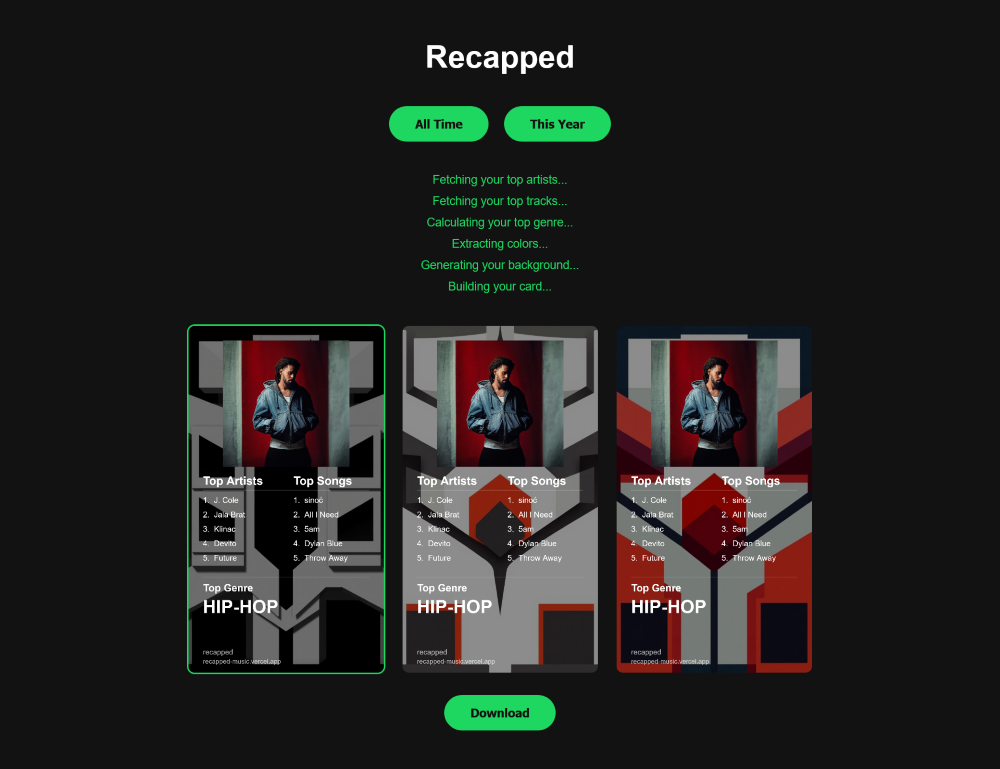

# Recapped
> Recapped is an independent project and is not affiliated with, endorsed by, or sponsored by Spotify.

Create personalized music recap posters from your Spotify listening history, whenever you want.



**Live:** [recapped-music.vercel.app](https://recapped-music.vercel.app)

## What it does

Recapped connects to your Spotify account, fetches your listening data, extracts album artwork colors, generates AI-powered backgrounds, and composites everything into downloadable poster-style recap cards.

Choose between three generated variants and save your favorite as a JPEG.

## How it works

1. **Connect with Spotify** — secure OAuth login using PKCE
2. **Pick a range** — All Time or This Year
3. **Fetch listening data** — top artists, top tracks, and a calculated top genre
4. **Extract colors** — dominant colors are pulled from your album artwork
5. **Generate backgrounds** — three AI-generated designs are created
6. **Composite the final card** — choose your favorite and download it

## Tech stack

- **Frontend:** Vite, Vanilla JS, HTML Canvas
- **Backend:** Vercel Serverless Functions
- **Data:** Spotify Web API, Last.fm API
- **Image generation:** Pollinations.ai
- **Session storage:** Upstash Redis
- **Hosting:** Vercel

## Security

- OAuth + PKCE authentication
- Third-party API keys never reach the browser
- Requests are proxied through serverless functions
- Spotify refresh tokens are stored server-side in Redis
- API routes validate input, verify request origins, and are rate-limited

## Successful recap counts on Vercel Hobby

Production completions are recorded through `POST /api/recap-completed`. No stats page, Web Analytics custom event, paid observability feature, new dependency, or new environment variable is required. The endpoint uses the existing `UPSTASH_REDIS_REST_URL` and `UPSTASH_REDIS_REST_TOKEN`. Preview and development deployments skip counting.

`src/app.js` reports completion only after all three `generateCard` promises resolve, all three display canvases are drawn, and the results view is shown. One generation run has one random UUID. Individual backgrounds, visits, login attempts, failed runs, selecting a poster, and downloads do not report completion. Creating another complete recap intentionally counts again, even within the same Spotify login.

The browser sends only `{ recapId, completedAt }`, where `completedAt` is an ISO timestamp. The existing HttpOnly session cookie accompanies the request for authentication; no Spotify data is added to the payload. Pending reports are kept in tab-scoped session storage and retried up to three times per flush, using the same ID and timestamp. They are retried after a logged-in refresh or when connectivity returns. Refreshing does not generate a new completion.

The endpoint checks the exact production origin and uses one Redis Lua operation to check the existing session, deduplicate the recap ID, and increment its UTC completion-day counter. Analytics keys contain no session ID, Spotify identity, tokens, IP address, artist, track, or listening history. Existing OAuth/session storage and rate limits are unchanged.

Each newly recorded completion emits one structured server log, for example:

```json
{"event":"recap_generated","version":1,"day":"2026-09-16","daily_total":12}
```

The log does not include the recap ID or session cookie. Vercel can attach its own standard request metadata independently of this application log. The first accepted request returns HTTP 201; duplicate reports return 200 without another success log. Do not count all requests to the endpoint, because those include retries and rejected requests.

### View counts in Vercel

1. Deploy these changes to the production project through your usual deployment process. Counting starts with this version; existing recaps cannot be backfilled.
2. Open **Vercel Dashboard → Recapped project → Logs** in the project sidebar.
3. Set **Environment** to **Production** and the timeline to **Last hour**, or use **Live** while generating a recap.
4. Enter `recap_generated` in the log search box. If a deployment filter is active, clear it to include all production deployments.
5. Open a matching request and inspect its JSON log. Each matching `recap_generated` line represents one newly accepted completion.
6. For a particular UTC date, inspect the `day` field. The **largest `daily_total`** shown for that date is its cumulative recorded count as of that event, including earlier completions whose individual logs have expired. Do not sum `daily_total` values. Concurrent requests can log out of order, so use the largest total rather than merely the newest row.

Hobby currently retains runtime logs for **one hour**. You cannot select yesterday and recover expired logs. A current log with `daily_total: 12` tells you that 12 completions have been recorded for that UTC date, even if only two event lines remain visible. If there is no retained event for the day, Logs cannot show that day's total; absence of logs does not mean zero recaps. Late deliveries can update the previous day's count for up to 24 hours after completion.

Vercel's documented free Observability tier retains only 12 hours of metrics, has no Query access, and lacks request-path breakdowns. Web Analytics Custom Events require Pro or Enterprise. Consequently this implementation does not offer a persistent daily graph inside Vercel Hobby, nor does it treat request totals as exact completion counts.

### Retained totals and limits

The existing Redis database keeps anonymous daily counts in the hash `recapped:analytics:daily`, with a `YYYY-MM-DD` field for each UTC day. These totals have no automatic expiry. For dates no longer visible in Vercel Logs, open the existing database in the Upstash console and run its read-only Redis command:

```text
HGET recapped:analytics:daily 2026-09-16
```

Use `HGETALL recapped:analytics:daily` for all recorded dates. A missing date means no completion reports were recorded for it, not proof that no user generated a recap. This is the historical fallback in your existing database, not a new website page or a native Vercel chart.

Anonymous deduplication markers under `recapped:analytics:completed:<random UUID>` expire after seven days. Reports older than 24 hours or more than five minutes in the future are rejected, so an unchanged report cannot be counted again after its marker expires. Pending browser reports expire after 24 hours and are removed after acknowledgement. Closing the tab can discard unacknowledged reports.

The Redis counter is the durable source of truth. Redis updates and Vercel log delivery cannot form a single transaction: a function crash or lost log after the Redis commit can omit a log line while retaining the correct counter. Likewise, if a completion report never reaches the server before expiry, it cannot be counted. Analytics failures never turn a successful recap into an error screen. The server authenticates the report but cannot independently prove browser canvas rendering; this is application analytics, not a fraud-proof accounting system. UTC attribution depends on the browser clock within the validation limits.

These operations use the existing Redis and Vercel free allowances; they do not bypass their usage quotas. Keep the analytics hash and markers intact to preserve counts and deduplication.

Validation: `npm test` uses Node's built-in test runner with mocked Redis/network calls; `npm run build` checks the production bundle. Tests do not write to the live database or generate real analytics events.

Vercel references checked September 16, 2026:

- [Runtime Logs and retention](https://vercel.com/docs/logs/runtime)
- [Observability tier limitations](https://vercel.com/docs/observability/observability-plus)
- [Web Analytics Custom Events availability](https://vercel.com/docs/analytics/custom-events)
